<!-- ============================================================
     CONCEPT 2 — "Follow the White Rabbit"
     Palette: white #F5F5F7 · silver #A1A1AA · bg #0B0B0F · accent #E4E4E7
     Needs assets/banner.svg in the repo (rabbit banner).
     ============================================================ -->

<div align="center">




<br/>

<a href="https://www.linkedin.com/in/ulrich-bezuidenhout-786431341/"></a>
<a href="mailto:uli.bez1112@gmail.com"></a>
<a href="https://www.upwork.com/freelancers/~01815c5799599b51e7"></a>


</div>

---

### 🕳️ Level 1 · Who's down here

I'm **Ulrich**, a final-year Application Development student in Cape Town 🇿🇦 and a freelance .NET developer. I go down rabbit holes on purpose: an old desktop app becomes a SaaS product, and a messy schema becomes a clean API. I keep going until it ships.

```yaml
rabbit:
  burrow:    Cape Town, ZA
  speaks:    [C#, SQL, JavaScript]
  digs_with: [ASP.NET Core 8, Blazor, EF Core, Razor Pages]
  stores_in: [PostgreSQL, SQL Server, Azure Blob]
  ships_on:  [Docker, Azure, Render]
  status:    graduating 2026 · open to contracts
```

<div align="center">
  
</div>

---

### 🕳️🕳️ Level 2 · What I've built

| | Project | What it does | Stack |
|---|---|---|---|
| 🎬 | **[YouTubeIdeationWeb](https://github.com/TwistyRabbit114/youtube-ideation-we)** · [live](https://youtube-ideation-web.onrender.com) | AI-assisted video idea planner with paid plans. Started as a WinForms app; rebuilt for the web | `ASP.NET Core 8` `Stripe` `Gemini` `PostgreSQL` |
| 🥬 | **FreshKeep** | Fridge & pantry tracker PWA with expiry alerts and AI recipe ideas | `Blazor Server` `PWA` `EF Core` |
| 🚚 | **[GLMS](https://github.com/TwistyRabbit114/GLMS)** | Logistics platform: REST API + MVC front end, JWT auth, 3-container Docker setup, 38 tests | `Web API` `Docker Compose` `xUnit` |
| ☁️ | **[AbcRetail.StorageDemo](https://github.com/TwistyRabbit114/AbcRetail.StorageDemo)** | Retail demo on Azure Storage: blobs, tables and queues | `ASP.NET Core` `Azure` |

---

### 🕳️🕳️🕳️ Level 3 · Proof of digging

<div align="center">
  
  
  <br/>
  
  <br/><br/>
  
</div>

---

<div align="center">

*You've reached the bottom of the burrow. Pick a tunnel:*

<a href="https://github.com/TwistyRabbit114?tab=repositories"></a>
<a href="mailto:uli.bez1112@gmail.com"></a>

</div>
